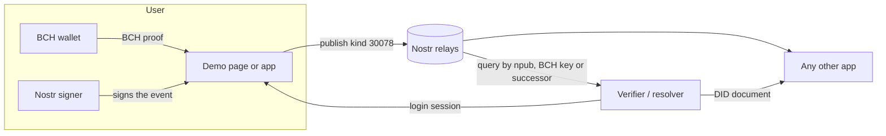

# bnd-core

BND binds a Bitcoin Cash key to a Nostr key so that anyone can check that one
person controls both. Each key signs a statement naming the other. The binding
is published as an ordinary Nostr event, found on any relay, and verified
offline by whoever needs it. There is no identity provider, no account, no fee
and no on-chain transaction, and no private key leaves its owner.

On top of the binding, BND adds:

- **Login** with a one-time challenge signed by both keys, or by the Nostr key
  alone, checked against relays to make sure the binding is still current.
- **Key rotation, recovery and revocation.** A binding can be replaced; each
  change needs two of three keys (Nostr, BCH and an optional offline recovery
  key), and every binding carries its full signed history.
- **A DID**, `did:bnd:<network>:<root Nostr key>:<root binding ID>`, that stays
  the same when keys rotate, with a public resolver.
- **Pay by identity:** turn an npub or a DID into a payment request for the
  identity's current, verified BCH address, in BCH or CashTokens.

Status: draft protocol, working reference implementation. Release 0.3.0.

## Try it

Hosted demo: <https://bnd-core.septemlabs.com> (chipnet by default). The public
DID resolver is at `https://bnd-core.septemlabs.com/did/<did>`.

Locally, with Node.js 22 or later:

```bash
npm install
npm run demo
```

Open <http://127.0.0.1:4173>. This starts a local relay, the demonstration
login service and the page, on this machine only. [docs/demo.md](docs/demo.md)
walks through it step by step.

## How it works



1. The wallet signs a BCH proof over the binding record: a Bitcoin Signed
   Message, or a transaction that spends a virtual output and can never be
   broadcast.
2. The Nostr key signs a kind `30078` event carrying the record and that proof.
3. The event goes to relays. Anyone finds it by Nostr key, by BCH key hash, or
   as the successor of an older binding.
4. A verifier checks both signatures and the history locally. Relays are
   untrusted: they can withhold events but cannot forge them.

[docs/architecture.md](docs/architecture.md) explains the design for readers
who know Bitcoin Cash or identity systems but not both, with sequence diagrams
and a step-by-step verification.

## Packages

| Path             | Package                   | What it does                                                        |
| ---------------- | ------------------------- | ------------------------------------------------------------------- |
| `packages/core`  | `@cashlet-labs/bnd-core`  | Records, proofs, binding events, succession, login. No network.     |
| `packages/nostr` | `@cashlet-labs/bnd-nostr` | Publish to and discover from relays; check a binding is current.    |
| `packages/did`   | `@cashlet-labs/bnd-did`   | `did:bnd` documents and resolution, pay by identity, `bnd-resolve`. |
| `apps/web`       | (private)                 | The demo page.                                                      |
| `apps/verifier`  | (private)                 | Demonstration login service and public DID resolver.                |
| `apps/dev-relay` | (private)                 | In-memory relay that enforces succession, for the demo and tests.   |

The packages are not on npm yet; build them from this repository
(`npm run build`). [docs/integration.md](docs/integration.md) shows how wallets,
Nostr clients and applications use them.

## Documentation

| Document                                                 | For                                                           |
| -------------------------------------------------------- | ------------------------------------------------------------- |
| [spec/BND-1.md](spec/BND-1.md)                           | The protocol: records, proofs, events, login, rotation.       |
| [spec/did-bnd.md](spec/did-bnd.md)                       | The `did:bnd` DID method.                                     |
| [spec/nip-draft.md](spec/nip-draft.md)                   | BND written up as a NIP for Nostr developers.                 |
| [spec/vectors/](spec/vectors/)                           | Test vectors for every part of the spec.                      |
| [docs/architecture.md](docs/architecture.md)             | How BND works, with diagrams and a verification walk-through. |
| [docs/integration.md](docs/integration.md)               | Adding BND to a wallet, a Nostr client or an application.     |
| [docs/threat-model.md](docs/threat-model.md)             | What BND defends against, and what it does not.               |
| [docs/demo.md](docs/demo.md)                             | Running and using the demo.                                   |
| [docs/wallet-connections.md](docs/wallet-connections.md) | How the demo talks to BCH wallets.                            |
| [docs/deploy.md](docs/deploy.md)                         | Hosting the demo with Docker.                                 |
| [docs/did-rubric.md](docs/did-rubric.md)                 | `did:bnd` evaluated against the W3C DID Method Rubric.        |
| [docs/bounty-checklist.md](docs/bounty-checklist.md)     | Where each bounty requirement is met.                         |
| [CHANGELOG.md](CHANGELOG.md)                             | Releases.                                                     |

## Standards reused

Nostr NIP-01, 06, 07, 09, 19, 21, 46, 65, 78 and 98; Bitcoin Signed Message;
BIP-340, BIP39, BIP44 and BIP21; CashAddr and CashTokens token-aware addresses;
RFC 8785 (JSON canonicalization); CAIP-2, CAIP-10 and CAIP-122; W3C DID Core,
DID Resolution and Controlled Identifiers (Multikey).

## Development

```bash
npm run dev          # page with hot reload on http://127.0.0.1:5173
npm run typecheck
npm run lint
npm run format:check
npm test
npm run test:e2e     # browser tests (Playwright)
```

See [CONTRIBUTING.md](CONTRIBUTING.md). Report security problems as described in
[SECURITY.md](SECURITY.md).

## Licence

Code: MIT, see [LICENSE](LICENSE). Specification text in `spec/`: CC BY 4.0, see
[spec/LICENSE.md](spec/LICENSE.md).
