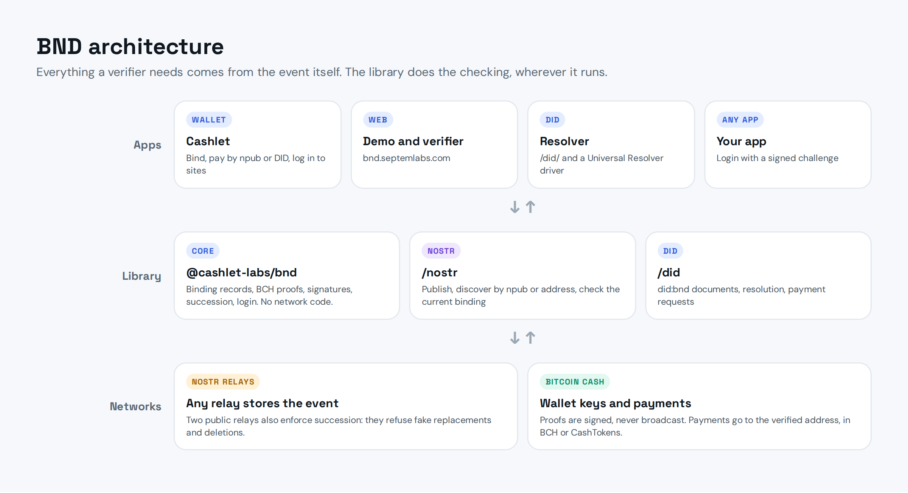
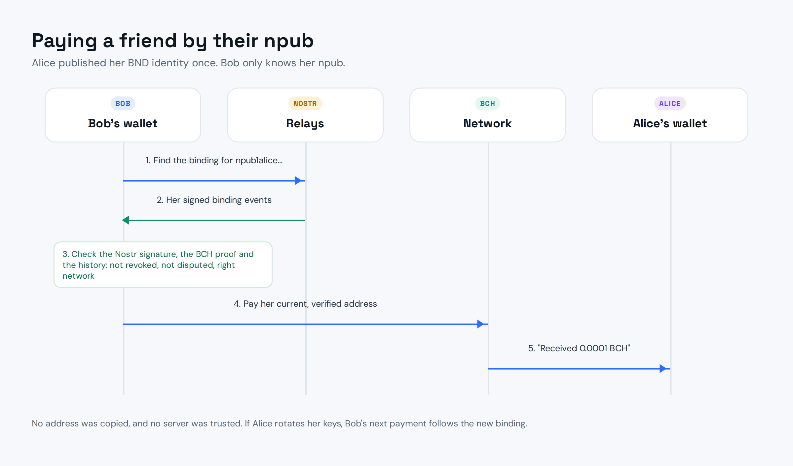
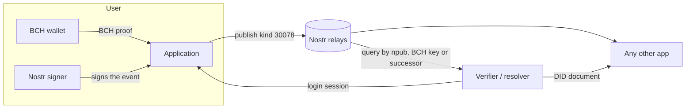
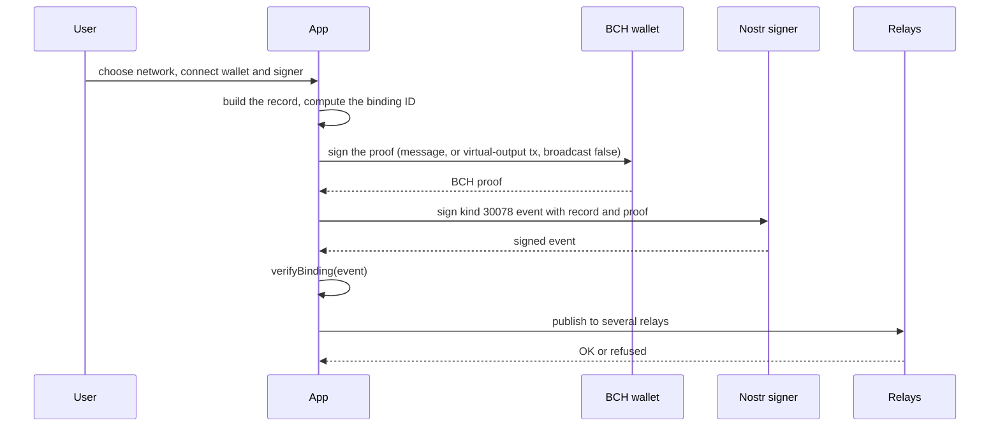
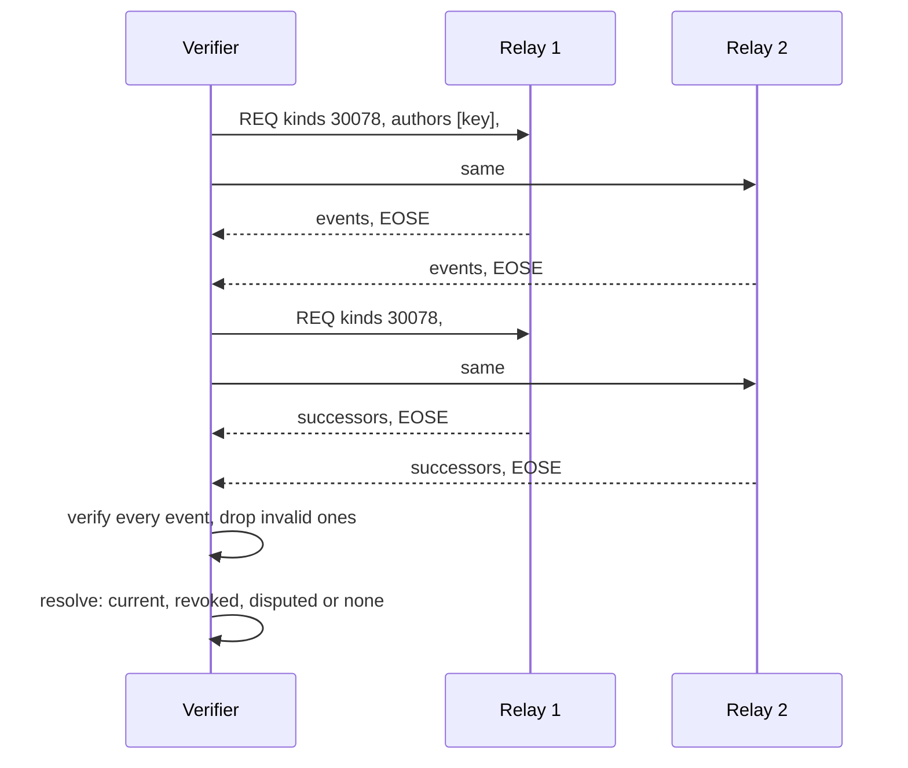
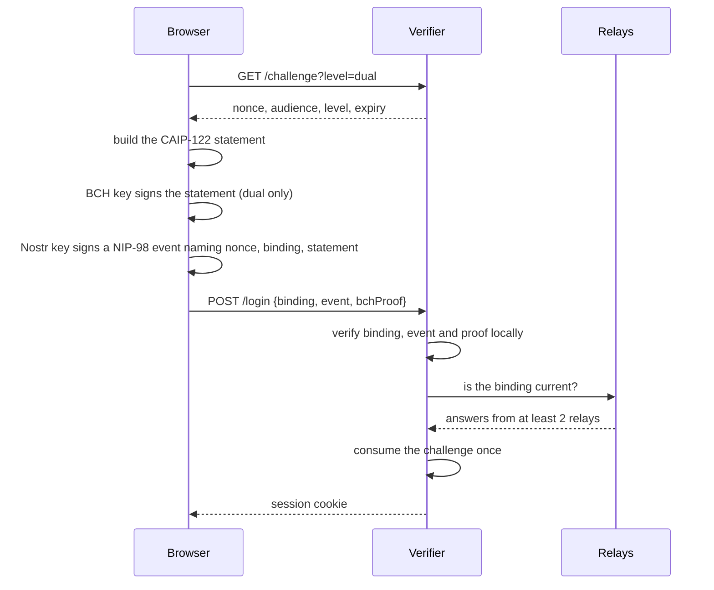
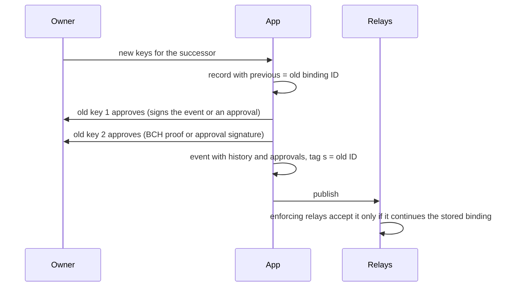

# How BND works

This is an introduction for readers who know Bitcoin Cash or identity systems,
but not necessarily both. The normative rules are in
[spec/BND-1.md](../spec/BND-1.md) and [spec/did-bnd.md](../spec/did-bnd.md);
section numbers below refer to BND-1 unless stated otherwise.

## The problem

A Bitcoin Cash user has a wallet key. A Nostr user has a key that signs their
posts. Today, linking the two means posting an address in a profile or a note.
Nothing proves the poster controls the address, so a profile that was taken
over, or a relay that serves a fake profile, can redirect payments.

BND makes the link a pair of signatures: the BCH key signs a statement naming
the Nostr key, and the Nostr key signs an event containing that statement. A
verifier needs only the event and the public keys inside it.

## The pieces







The wallet and the signer hold the keys. Relays store events but are not
trusted for anything except availability. Every application verifies what it
reads by itself.

## Background in two paragraphs

**For identity readers.** A Bitcoin Cash P2PKH address is the HASH160 of a
secp256k1 public key. Wallets can sign a text message with the key ("Bitcoin
Signed Message") or sign a transaction. BND uses either, so it works with
wallet connections that only support one. No transaction is ever broadcast and
no chain access is needed to verify.

**For Bitcoin Cash readers.** Nostr is a protocol of signed JSON events stored
on relays, which are simple servers anyone can run. Each user is a BIP-340
Schnorr key. Relays do not agree with each other and can withhold events, but
they cannot forge them, so clients ask several and check every signature
themselves. "Addressable" events (kinds 30000–39999) are replaced by newer ones
with the same author and `d` tag.

## The binding

A binding record is a small JSON object (section 3):

```json
{
  "bch": { "keyHash": "<20-byte HASH160>", "network": "chipnet" },
  "createdAt": 1795132800,
  "nostr": { "publicKey": "<32-byte x-only key>" },
  "protocol": "bnd",
  "version": 1
}
```

Its binding ID is the SHA-256 of its canonical JSON (RFC 8785) with a domain
tag. The BCH key signs a proof that names the binding ID (section 4), and the
record and proof are published as the content of a Nostr kind `30078` event
signed by the Nostr key (section 5):

```text
kind 30078, tags [["d","bnd1"], ["b","<BCH key hash>"]]
content {"bchProof": {...}, "record": {...}}
```

The `d` tag means a Nostr key has one live binding. The `b` tag lets anyone find
the Nostr identities that claim a BCH key; those claims are verified like any
other.

## Creating and publishing



The transaction proof (section 4.2) spends an output that does not exist: its
outpoint is a hash of the binding ID. The signature, with hash type `0x61`,
commits to that outpoint and to an `OP_RETURN` carrying the binding ID, so it is
valid only for this binding and moves nothing on any chain.

## Discovering and verifying



The same search works from a BCH address with `#b` and the key hash. A
verifier repeats the `#s` query from the newest binding it has until nothing
new appears, so it finds a binding that moved to a new Nostr key.

## Verification walk-through

Given one binding event, a verifier needs no network (section 7):

1. **Shape.** The event is a valid NIP-01 event of kind `30078`, and the content
   is canonical JSON with exactly the members its form allows.
2. **Record.** Every member is valid, hex is lowercase and of the right length,
   and there are no unknown members.
3. **Event matches record.** The author is the record's Nostr key, `created_at`
   equals `createdAt`, and the tags are exactly `d`, `b` (and `s` for a
   successor), in order.
4. **Nostr signature.** The event ID and BIP-340 signature are valid. This is the
   Nostr key's half of the binding.
5. **BCH proof.** For a message proof, rebuild the text from the record, recover
   the public key from the signature and compare its HASH160 to `bch.keyHash`.
   For a transaction proof, rebuild the expected transaction, require identical
   bytes, and run the BCH script engine over the input. This is the BCH key's
   half.
6. **History.** For a successor, check every earlier step's signatures and that
   two keys of the step before approved each change (section 9).

Whether the binding is **current** is a separate question that needs relays:
no newer successor, no revocation and no competing chain (sections 8.7 and 9.6).
The verifier asks several relays and fails when too few answer completely.

In code:

```ts
import { verifyBinding } from "@cashlet-labs/bnd";
import { discoverBinding } from "@cashlet-labs/bnd/nostr";

const local = verifyBinding(event); // one event, no network
const found = await discoverBinding("npub1…", { relays }); // found.state.status
```

## Logging in



The level is chosen by the application: `dual` proves both keys now, `nostr`
only the Nostr key. A `nostr` session is refused for actions that need `dual`
(section 8.1). The verifier also pins the binding each Nostr key last logged in
with and refuses a later binding that does not continue it (section 9.7).

## Rotation, recovery and revocation

Relays keep only a key's newest binding, so a successor carries the steps
before it, like a chain of block headers that a light client can check
(section 9.3). Each change needs two of the previous binding's keys:

| Change                   | Typical approvers          |
| ------------------------ | -------------------------- |
| Rotate the BCH key       | Nostr key and old BCH key  |
| Rotate the Nostr key     | Old Nostr key and BCH key  |
| Recover a lost Nostr key | BCH key and recovery key   |
| Recover a lost BCH key   | Nostr key and recovery key |
| Revoke                   | Any two                    |



A stolen Nostr key alone cannot do this. The thief can publish a second, fake
first binding, which makes the identity **disputed** rather than taken over.
Relays that enforce succession (section 9.8), such as the ones the demo uses,
refuse to let it overwrite the real binding at all. The demo's "Try a takeover"
step shows each defence.

## The DID

`did:bnd:<network>:<root Nostr key>:<root binding ID>` names the first binding
of a chain. Resolving it follows successors from that root to the head and
returns a DID document with the current Nostr key, the current BCH key as a
CAIP-10 account, and the recovery key if there is one
([spec/did-bnd.md](../spec/did-bnd.md)). Rotations change the document, not the
DID. A thief's second root has a different DID, so it cannot affect this one.

## Paying an identity

`resolvePayee` turns an npub or a DID into the identity's current verified
address, refusing when relays disagree, too few answer, or the identity is
revoked or disputed. `paymentUri` builds a BIP21 `bitcoincash:` request. The
same key's token-aware `z…` address is given for CashTokens; no cross-wallet
standard for token payment requests exists yet.

## What runs where

| Component    | Holds keys | Needs network       | Trusted for                     |
| ------------ | ---------- | ------------------- | ------------------------------- |
| BCH wallet   | BCH        | only its own link   | signing what the user approves  |
| Nostr signer | Nostr      | NIP-46 relays only  | signing what the user approves  |
| Demo page    | none¹      | relays and verifier | nothing: it verifies everything |
| Relays       | none       | yes                 | availability only               |
| Verifier     | none       | relays              | its own sessions                |

¹ Unless the user creates a test key or a recovery key in the page; those live
only in the tab's memory.
